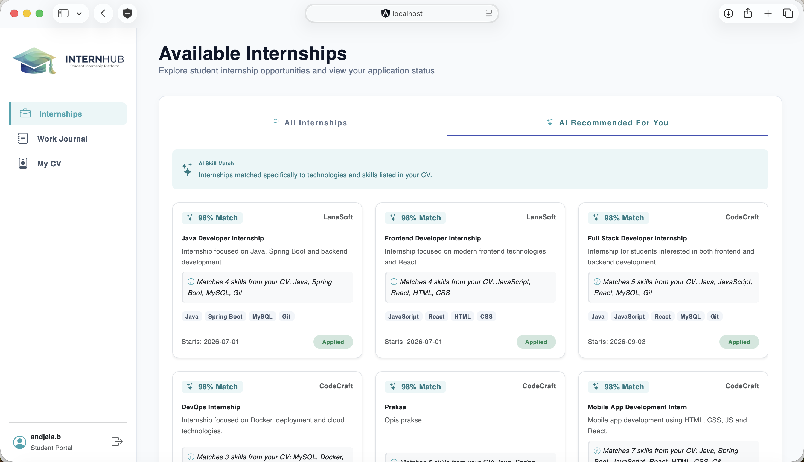
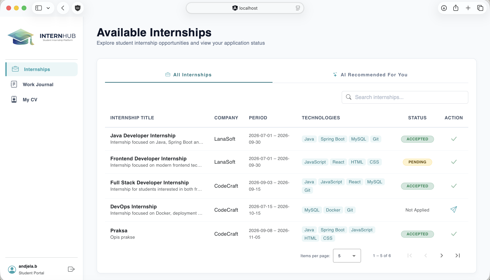
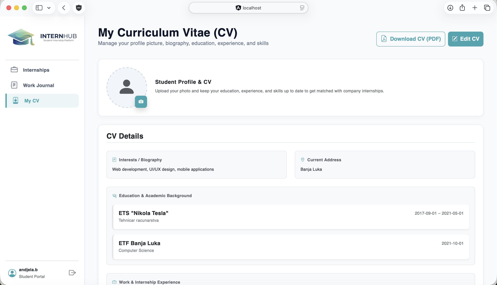
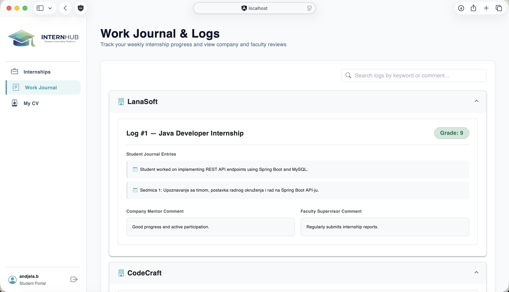
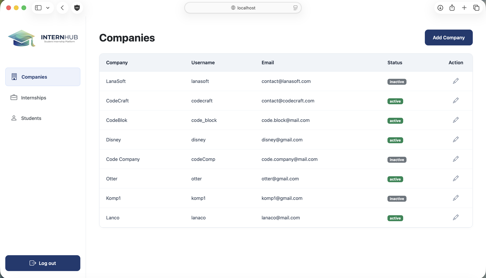
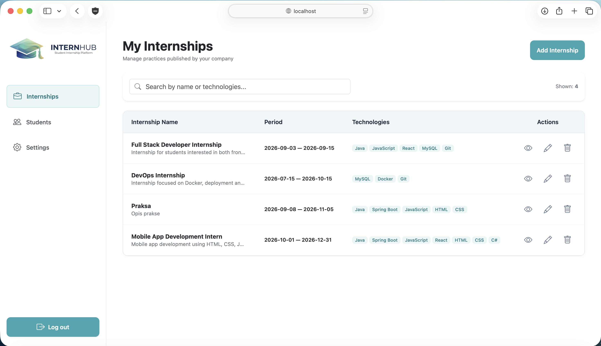

# Student Internship System 🎓💼

A comprehensive, multi-tier platform for managing university student internships with **AI-powered internship recommendations**, **Europass CV management**, **weekly work diaries (dnevnici rada)**, **progress tracking & evaluation**, and an **RSS 2.0 feed**.

Developed as part of the **Internet Programming (Internet programiranje)** coursework at the **Faculty of Electrical Engineering, University of Banja Luka (ETF Banja Luka)**.

---

## 📌 Overview

The **Student Internship System** simplifies and digitizes the entire lifecycle of student academic internships. It connects three distinct user roles in a synchronized workflow:

1. **Students**: Build professional Europass CVs, explore and filter available internships, receive tailored **AI-recommended matches**, apply for positions, and keep weekly work journals.
2. **Companies**: Post and maintain internship listings, review candidate applications with full CV previews and **PDF downloads**, mentor students by reviewing weekly logs, and submit final evaluations.
3. **Faculty Supervisors**: Approve/deactivate company accounts, monitor all internship announcements, manage student accounts (including **bulk import via CSV**), and oversee student journals and evaluations.

---

## 🏛 Architecture & System Design

The system is built as a modular multi-tier architecture where three specialized client applications communicate with a centralized Spring Boot REST API backed by a single MySQL relational database:

```text
                            ┌───────────────────────────────────┐
                            │           Groq AI LLM             │
                            │   (CV & Internship Matcher API)   │
                            └─────────────────▲─────────────────┘
                                              │ REST (JSON)
                                              ▼
                            ┌───────────────────────────────────┐
                            │        MySQL Database             │
                            │        (internship_db)            │
                            └─────────────────▲─────────────────┘
                                              │ JPA / Hibernate
                                              ▼
                            ┌───────────────────────────────────┐
                            │        Spring Boot Backend        │
                            │           (`intern-hub`)          │
                            │   REST API • JWT Security • RSS   │
                            └─────▲───────────▲───────────▲─────┘
                                  │           │           │
                 REST (JSON / JWT)│           │REST (JSON)│REST (JSON)
         ┌────────────────────────┘           │           └────────────────────────┐
         ▼                                    ▼                                    ▼
┌──────────────────┐               ┌──────────────────────┐             ┌──────────────────────┐
│   Student App    │               │     Faculty App      │             │     Company App      │
│  (Angular 16)    │               │    (JSP Model 2)     │             │    (JSP Model 1)     │
│  SPA + Material  │               │ Servlets + MVC + CSS │             │ JavaBeans + JSP+ CSS │
└──────────────────┘               └──────────────────────┘             └──────────────────────┘
```

---

## 🚀 System Components & Key Features

### 1. Backend API (`intern-hub`)
- **RESTful Endpoints**: Clean API covering authentication, students, faculties, companies, internships, applications, CVs, and work journals.
- **Security & Authorization**: Stateless authentication using **Spring Security** and **JWT (JSON Web Tokens)** with role-based access validation.
- **AI Recommendation Engine**: Integrates with LLM API (Groq) to match student qualifications and interests with internship prerequisites, producing ranked compatibility scores (0–1) and personalized justifications.
- **RSS 2.0 Feed**: Public endpoint (`/api/v1/internships/rss`) delivering real-time XML feeds of published internship opportunities.
- **Database Logic Isolation**: Compliant with strict constraints (no stored procedures or triggers; all business and relational integrity rules are handled within the Java domain layer).

### 2. Student Application (`student-app`)
- **Technology**: Single Page Application (SPA) built with **Angular 16**, **Angular Material**, and **Bootstrap 5**.
- **Europass CV Builder**: Complete profile builder for personal data, profile picture upload (with automatic compression and storage), education, previous work experience, technical skills, and career interests.
- **Internship Catalog & Search**: Tabular and detail views with search filters across companies and technologies, plus paginated browsing.
- **AI Recommendations Tab**: Modern UI card presentation displaying the top 5 AI-recommended internships with matching percentages and generated rationales.
- **Weekly Work Journal (Dnevnik rada)**: Interface for logging tasks and learning achievements on a week-by-week basis during an active internship.

### 3. Faculty Application (`faculty-app`)
- **Technology**: Built using **JSP Model 2 (MVC Architecture)** with Java Servlets, JSTL, and Bootstrap 5 responsive layout (mobile-first).
- **Company Management**: View, create, activate, and deactivate partner company accounts.
- **Internship Oversight**: Monitor all active internship announcements across partner organizations.
- **Student Data Management (CRUD & CSV Import)**: Full student profile maintenance, including batch account creation by uploading structured CSV files.
- **Internship Supervision**: Review student work journals, monitor mentor feedback from companies, and record final grades.

### 4. Company Application (`company-app`)
- **Technology**: Built using **JSP Model 1 (JSP + JavaBeans)** with responsive Bootstrap 5 styling and custom teal brand identity (`#37A5B0`).
- **Internship CRUD**: Create, edit, and close internship postings with details on required technologies, duration, and requirements.
- **Applicant Review & PDF CV Export**: Inspect student applicants, view full Europass CV data, accept or reject candidates, and **download CVs in PDF format**.
- **Student Mentorship & Evaluation**: Inspect weekly student journal entries, leave mentor comments, and submit internship evaluations.
- **Account Management**: Company profile oversight and password management.

---

## 📸 Screenshots & Visuals

### Student Application (Angular 16)
| AI Recommendations | Available Internships |
| :---: | :---: |
|  |  |

| Europass CV Editor | Weekly Work Journal |
| :---: | :---: |
|  |  |

### Faculty Application (JSP Model 2) & Company Application (JSP Model 1)
| Faculty: Company & Student Management | Company: Applicants & Evaluations |
| :---: | :---: |
|  |  |

---

## 🛠 Tech Stack

| Domain | Technologies & Libraries |
| :--- | :--- |
| **Backend** | Java 17+, Spring Boot 3, Spring Data JPA, Spring Security, JWT (jjwt), RestClient |
| **Student Frontend** | Angular 16, TypeScript, Angular Material, Bootstrap 5, RxJS, HTML5 / CSS3 |
| **Faculty Frontend** | JSP Model 2 (MVC), Java Servlets, JSTL, Bootstrap 5, Mobile-responsive CSS |
| **Company Frontend** | JSP Model 1 (JSP + JavaBeans), Bootstrap 5, Custom `#37A5B0` Theme |
| **Database** | MySQL 8.x |
| **AI / LLM** | Groq API (`groq/compound-mini` / OpenAI-compatible endpoint) |
| **Build & Tooling** | Apache Maven, Angular CLI, Apache Tomcat 9, Git |

---

## 🗄 Database Model

The database schema (`internship_db`) contains the following core entities:
- `user`: Base authentication table storing credentials, email, and role associations.
- `faculty`: Academic institutions overseeing the internship programs.
- `company`: Partner businesses and active/inactive status flag.
- `student`: Student demographic records, faculty linkage, and contact information.
- `internship`: Internship listings with description, start/end dates, and constraints.
- `technology` & `internship_technology`: Categorized skill tags assigned to positions.
- `application`: Student applications submitted for open internships (accepted/rejected/pending).
- `cv`, `education`, `experience`, `interest`, `cv_technology`: Detailed Europass-compliant student profile data.
- `work_journal` & `work_journal_entry`: Weekly student logs, mentor remarks, and review statuses.
- `evaluation`: Faculty and company evaluation reports and grades.

> SQL DDL script is located in [`database/internship_ddl.sql`](database/internship_ddl.sql) and sample seed data in [`database/test_data.sql`](database/test_data.sql).

---

## 🧠 AI Internship Matching Engine

The AI recommendation feature analyzes the semantic alignment between a student and active market offerings:
1. When a student visits the **AI Recommendations** tab, the frontend requests `/api/v1/internships/ai-recommendations/{studentId}`.
2. The backend constructs a structured context containing the student's CV details (specialization, skills, technical competencies, and career interests) alongside active internship postings.
3. The LLM evaluates compatibility and returns:
   - `matchPercentage`: Value between `0.0` and `1.0` representing profile compatibility.
   - `reason`: A concise, informative explanation of why this position matches the candidate.
4. The backend filters and sorts the top **5 best-fitting internships**, rendering them as interactive cards with direct application actions.

---

## 💻 Getting Started & Installation

### Prerequisites
- **Java Development Kit (JDK)**: Version 17 or higher
- **Node.js**: Version 18.x or 20.x & **npm**
- **MySQL Server**: Version 8.0+
- **Apache Tomcat**: Version 9.0 (for JSP web apps)
- **Maven**: Version 3.8+ (or use included `mvnw`)

---

### 1. Database Setup
1. Start your local MySQL server.
2. Open your preferred SQL client (e.g., MySQL Workbench, DBeaver) or terminal and execute:
   ```bash
   mysql -u root -p < database/internship_ddl.sql
   mysql -u root -p < database/test_data.sql
   ```
3. Verify that database `internship_db` is created and populated.

---

### 2. Backend Setup (`intern-hub`)
1. Open [`intern-hub/src/main/resources/application.properties`](intern-hub/src/main/resources/application.properties) and verify database credentials and properties:
   ```properties
   spring.datasource.url=jdbc:mysql://127.0.0.1:3306/internship_db
   spring.datasource.username=USERNAME
   spring.datasource.password=PASSWORD
   
   # Groq AI Key for internship recommendations
   groq.api.key=YOUR_API_KEY_HERE
   ```
2. Navigate to the backend directory and launch the Spring Boot service:
   ```bash
   cd intern-hub
   ./mvnw spring-boot:run
   ```
3. The REST API will be accessible at: `http://localhost:8080/api/v1`
4. Verify the RSS feed: `http://localhost:8080/api/v1/internships/rss`

---

### 3. Student App Setup (`student-app`)
1. Navigate to `student-app` and install dependencies:
   ```bash
   cd student-app
   npm install
   ```
2. Start the Angular development server:
   ```bash
   npm start
   # or: ng serve
   ```
3. Open your browser and navigate to: `http://localhost:4200/`

---

### 4. Faculty & Company Apps (`faculty-app` & `company-app`)
Both web applications are dynamic web projects configured for **Apache Tomcat 9**:
1. Open the project in Eclipse IDE (Enterprise Java and Web Developers) or IntelliJ IDEA Ultimate.
2. Add both `faculty-app` and `company-app` to an Apache Tomcat v9 server instance.
3. Ensure the context paths and ports are configured:
   - Faculty Portal: `http://localhost:8080/faculty-app/` (or mapped Tomcat port)
   - Company Portal: `http://localhost:8080/company-app/`
4. Both applications connect directly to the running `intern-hub` REST backend for data synchronization.

---

## 📁 Project Structure

```text
student-internship-system/
│
├── intern-hub/                 # Spring Boot Backend (REST API, JWT, AI, RSS)
│   ├── src/main/java/          # Controllers, Services, Repositories, DTOs, Entities
│   └── src/main/resources/     # application.properties & configuration
│
├── student-app/                # Student Client (Angular 16 SPA)
│   ├── src/app/components/     # Login, Navbar, Sidebar, CV, Internships, Work Journal
│   └── src/app/services/       # API integration services & JWT interceptors
│
├── faculty-app/                # Faculty Portal (JSP Model 2 / MVC Architecture)
│   ├── src/main/java/          # Servlets & Controllers
│   └── src/main/webapp/        # WEB-INF/pages, components, CSS
│
├── company-app/                # Company Portal (JSP Model 1 Architecture)
│   ├── src/main/java/          # JavaBeans, DTOs, Service integration
│   └── src/main/webapp/        # JSP views, settings, student details, CSS
│
├── database/                   # Database scripts
│   ├── internship_ddl.sql      # Database schema (tables & constraints)
│   └── test_data.sql           # Test data dataset
│
├── docs/                       # Project documentation & visual assets
│   └── screenshots/            # UI screenshots for README showcase
│
├── LICENSE                     # MIT License
└── README.md                   # Main project documentation
```

---

## 📄 License

This project is licensed under the terms described in the [LICENSE](LICENSE) file.
